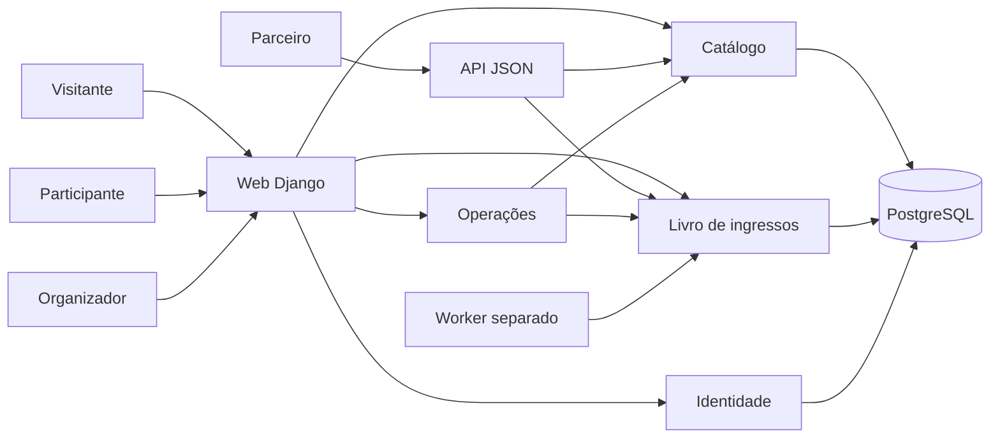
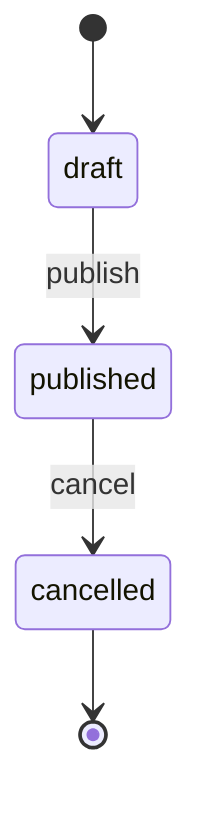
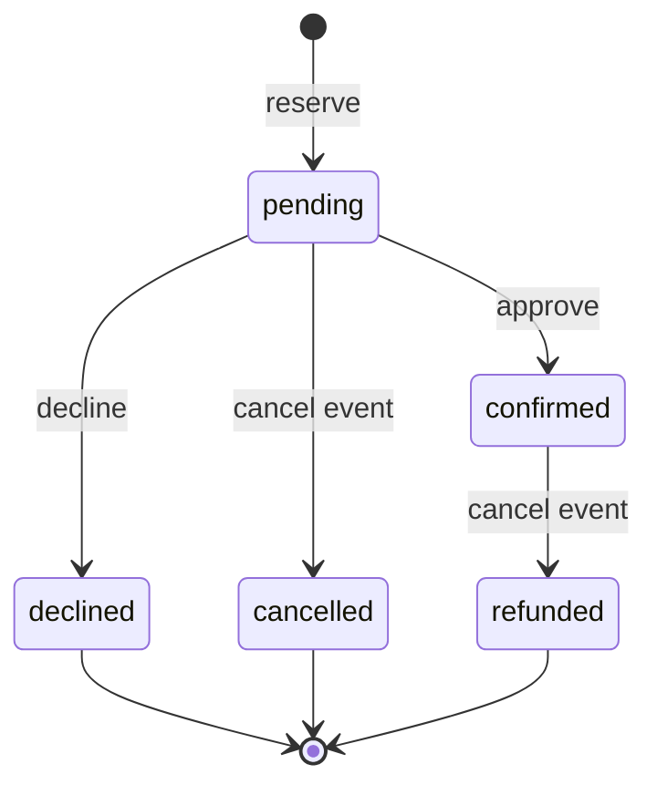

# Design | arquitetura e contrato de implementação

Status: proposta. PRD define comportamento; design define a solução, FDDs detalham execução. O código ainda não existe.

## 1. Drivers e limites

R07 e R11 exigem consistência mesmo com concorrência, R06 exige resposta assíncrona, R12 exige valor histórico, R13 exige autorização server-side. Linux/macOS + Docker + Git + Node LTS disponíveis; qualquer Python roda em container. Priorizar simples e verificável, não arquitetura distribuída. Nenhuma dependência de pagamento externo. O tempo de trabalho é limitado e a UI não é critério estético.

## 2. HLD: monólito modular



A aplicação serve templates e API, o worker aplica resultados agendados. Ambos usam mesma base, código de domínio e schema. O compose publica só web. O serviço bootstrap cria schema e seed antes de web/worker. Bibliotecas: Python 3.12, Django 5.2 LTS, psycopg 3, Gunicorn, Ruff, Playwright Python. PostgreSQL 17. Patch e digest específicos devem ser confirmados e congelados no kickoff, não usar latest. Aplicação com Gunicorn gthread (baseline 4 workers × 8 threads; ajustar só após teste de carga); conexões Django com CONN_MAX_AGE=0 nos testes; DB comporta web + worker + ferramentas (configurar max_connections e medir). Não usar devserver single-thread para carga.

## 3. Layout proposto do código

```text
app/
  config/             # settings, URL wiring, WSGI
  accounts/           # user model/authentication, Actor and guards
  coredata/           # event, ticket, payment job model + migrations
  catalog/            # events, ownership and inventory read, event lock
  ledger/             # reserve, payment resolution and ticket queries
  participant/        # public templates + participant adapters
  partner/            # JSON API adapter
  operations/         # check-in/cancellation/dashboard
  catraca_platform/   # bootstrap and readiness/heartbeat
  worker/             # entrypoint and persistent processing
  templates/          # base layout and module-local templates
  tests/              # unit, db integration, HTTP, browser, concurrency
bin/                  # up, down, gates, flow
```

F01 creates wiring, schema and the account model; F02 owns account behavior; F03 catalog and management shell; F04 ledger and worker; F05 participant; F06 partner; F07 operations and its management partial. Shared files `config/urls.py`, migration and base layout are coordinator-owned; F01/F03 add includes/slots in advance, not fake business handlers. Exact ownership and transfers are defined in the internal interface registry. The parallel wave edits separate modules and templates. No cross-feature monkey patching.

## 4. Logical model and constraints

| Entity           | Fields                                                                                                                                                    | Constraints / indexes                                                                                                                                                    |
| ---------------- | --------------------------------------------------------------------------------------------------------------------------------------------------------- | ------------------------------------------------------------------------------------------------------------------------------------------------------------------------ |
| User             | UUID id, normalized email, name, role, password hash, timestamps                                                                                          | unique normalized email; role participant/organizer; custom Django user before migration; session table built-in                                                         |
| Event            | UUID id, owner FK, name, venue, starts_at timestamptz, capacity int, price_cents bigint, status, published_at, cancelled_at                               | capacity 1..2^31−1; price 1..2^53−1; allowed status; owner immutable in services; owner+id and status+starts_at indexes; future enforced at create/edit, not by clock CHECK |
| Ticket           | UUID id, event FK, global code, channel, participant FK nullable, buyer_email, price_cents bigint, status, checked_in_at nullable, created_at, changed_at | code exactly 12 uppercase alphanumeric and unique; positive snapshot price <=2^53−1; allowed status/channel; web requires participant, partner null; indexes event+status and participant+created_at; code immutable |
| PaymentJob       | UUID id, ticket FK unique, outcome, due_at, state, processed_at, created_at                                                                               | DB permits zero or one job per ticket; canonical reserve creates exactly one in the same commit; queued/null or done|ignored/non-null processed_at; approved/declined; partial index queued on due_at |
| Worker heartbeat | singleton per worker identity, last_seen, started_at                                                                                                      | health freshness; no business derivation from heartbeat                                                                                                                  |

Database role used by application has necessary DML only; bootstrap owns DDL. A CHECK cannot enforce aggregate occupied≤capacity across rows. Do not claim arbitrary SQL writes are safe. Mutations of an existing Event/Ticket/PaymentJob aggregate must use canonical services and event lock; `create_event` is atomic but has no pre-existing Event row to lock. Direct ORM writes are allowed only for migration/fixture with review. Do not implement unprotected COUNT trigger as concurrency guard: two transactions can see the same committed snapshot. If stronger DB enforcement becomes needed, ADR must define atomic counter or serialized trigger and adversarial tests.

## 5. Machine of states





Check-in sets checked_in_at, does not transition status. It remains in history on refund; API checkedIn derives from presence, dashboard counts confirmed AND checked_in_at present. No transition out of terminal state. Event published may be edited while not cancelled. Draft cannot be cancelled. R01 validates start at create/edit; no extra automatic expiration. No event deletion or ticket transfer.

## 6. Transaction and consistency design

Refer to [transaction protocol](docs/architecture/transactions.md) for linearization, proof and tests. One event lock per mutation of an existing aggregate; event creation is only an atomic insert. Acquire event before tickets/jobs; query occupancy after lock in a new SQL command with READ COMMITTED. Never hold lock during external I/O or sleep. Reserve commits ticket and job together. Worker rechecks due/state under event lock and transitions exactly once. Cancellation commits event and all affected tickets together. Every read of capacity/status/metrics uses one statement snapshot. No cache, clamp, derived revenue counters or per-channel inventory.

## 7. Interface contracts

[Internal ports and ownership](docs/interfaces/internal.md) define actor, DTO, return/error, transaction owner and import rules. [OpenAPI](docs/interfaces/partner.openapi.json) fixes partner API. Web paths and stable test selectors: [UI contract](docs/interfaces/web.md). Public API never requires browser cookie; key precedes parse. UI requires session/CSRF; ownership enforced in domain, not merely navigation. Unauthorized responses do not reveal event data. DTOs only expose necessary fields.

## 8. Time, money and ID conventions

UTC aware timestamps in DB; UI America/Sao_Paulo, API ISO 8601 with offset/Z. Date picker interpreted in UI timezone. Tests generate future relative dates and use controllable clock for unit/DB; real deadlines use monotonic elapsed time. BRL parsed with Decimal and exact cents, no floats or rounding excess decimals. Revenue sum is arbitrary-precision integer at application boundary; cents representation bounded to interoperable JSON integer range for priceCents. Ticket code generated CSPRNG, 12 uppercase alphanumeric, global uniqueness DB, savepoint collision retry; code can be typed case-insensitively (normalize uppercase+trim). UUID public IDs opaque, invalid UUID yields not found, no path parsing exceptions leak.

## 9. Runtime lifecycle and observability

Health: `/health/live` process, `/health/ready` DB + migrations/bootstrap complete + recent worker heartbeat; F01 worker scaffold heartbeat only until F04. Log request ID, operation, outcome, event/ticket ID, duration, SQLSTATE sanitized; never PAN, passwords, API key, session IDs or email. Log queue lag and errors to stdout; metrics not necessary for brief. Worker updates heartbeat even with empty queue; readiness stale >5s fails. No extra exposed telemetry ports. Compose down isolates project and preserves data. Gates use isolated environment and default delay for timing tests. See [harness](docs/validation/harness.md).

## 10. Quality attributes and testability

Correctness: no oversell and terminal states preserved under concurrent writes. Security: actor derived from session/key, role+owner and CSRF. Availability: durable jobs and idempotent bootstrap, health; no uptime promise beyond local harness. Maintainability: typed domain ports, migrations, stable IDs, docs generated from one traceability source. Performance: prove 30 concurrent requests with 5/25 and 5 confirmed within 10s; no claims without measurement. Tests at unit, PostgreSQL, HTTP, real browser, adversarial and release. See [test catalog](docs/validation/test-catalog.md).

## 11. Failure and recovery

DB unavailable: readiness fails, request generic 503/500, no fake success. Transaction abort: rollback; retry bounded only known-aborted operations; unknown commit outcome never auto-resubmit. Worker crash: queued persisted jobs consumed after restart. Cancel operation failure: no partial updates; retry user-visible. Code collision: retry only named unique constraint. Bootstrap failure: web/worker not ready, report error and preserve volume. Gate/merge failure: new commit and new report, no mutating historical evidence.

## 12. Decisions and open questions

See ADRs, [technical research](docs/architecture/research.md) and the [W0 version manifest](docs/architecture/version-manifest.md). Confirm the candidate manifest and platform support in W0; W1 materializes transitives/lockfile and repeats image smoke on supported architectures. No product benchmark was run for this baseline. API, business rules and deadlines are fixed. New scope requires amendment; diagrams show planned topology, not deployed services.
