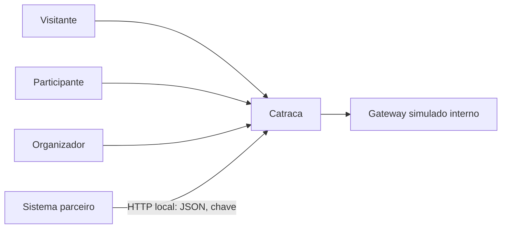
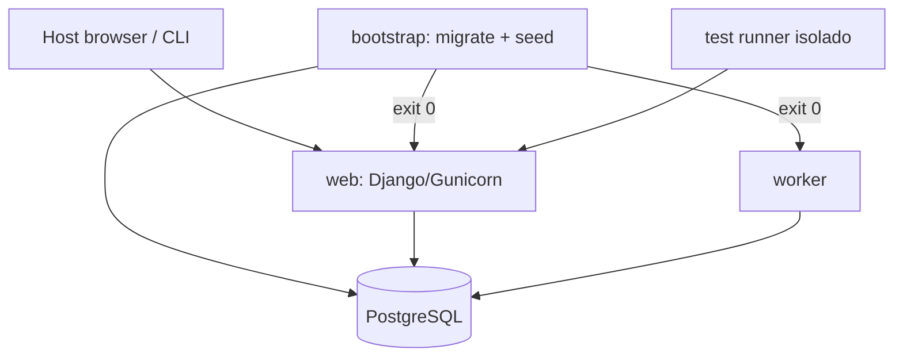
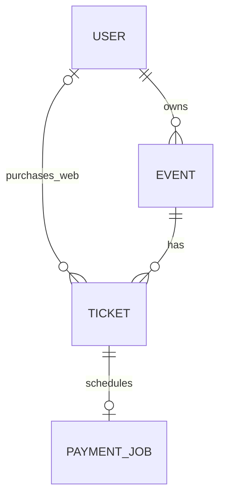
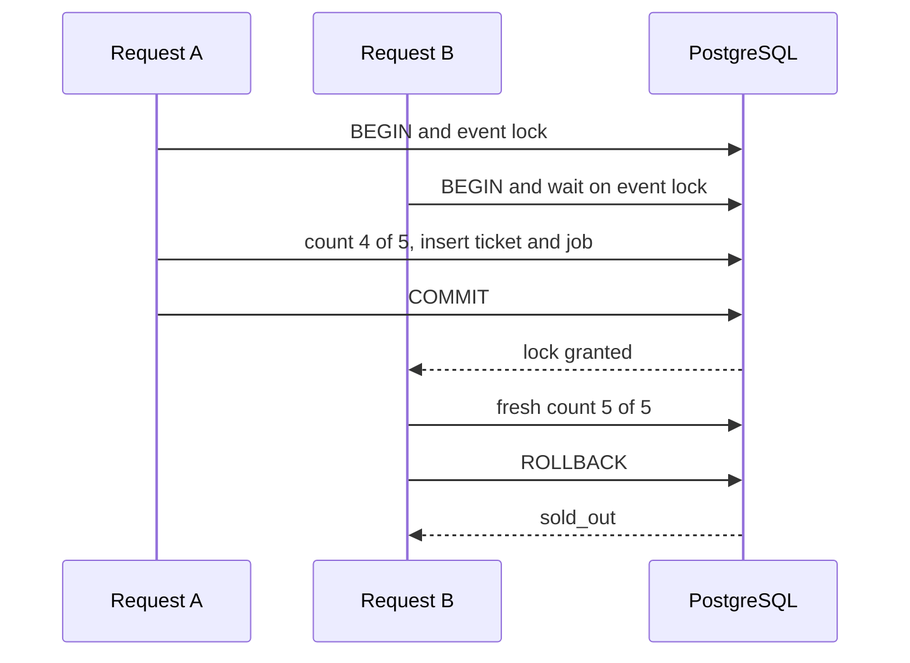
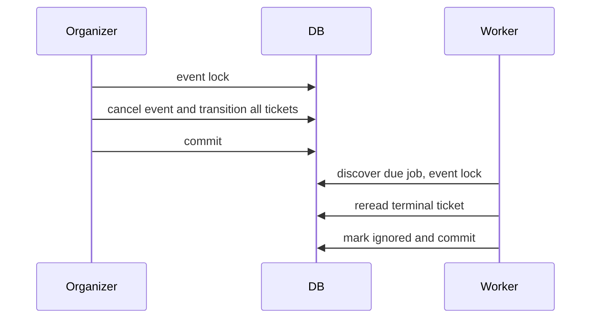
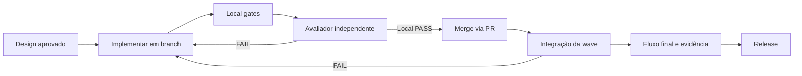

# Diagramas de design

## C1: contexto

Nota: transporte padrão HTTP em loopback; TLS fora de escopo. C2/C3 em design.md: web, bootstrap, worker, DB e módulos.

## C2: containers

## ER lógico

Parceiro não é User. A cardinalidade física é zero-ou-um job por ticket; o serviço
canônico `reserve` cria ticket e exatamente um job no mesmo commit. Status,
constraints e índices estão no design. Modelagem física na migration F01.

## Reserva concorrente

## Resolução e cancelamento

Se worker vence primeiro, cancelamento observa novo status e estorna se confirmado.

## Ciclo de entrega

Diagramas planejados, validar sintaxe Mermaid na W0. C4 Code-level será atualizado após implementação quando útil.
