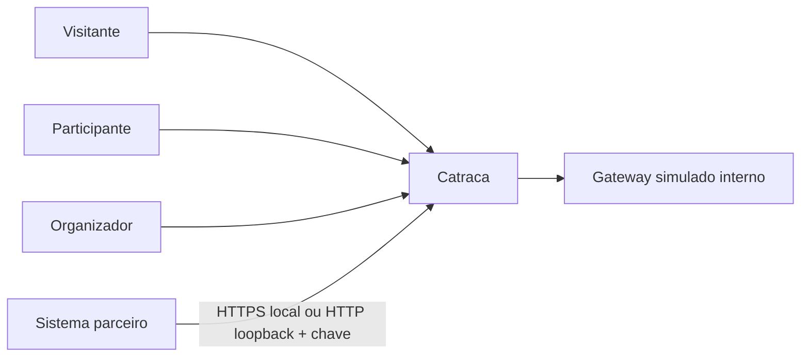
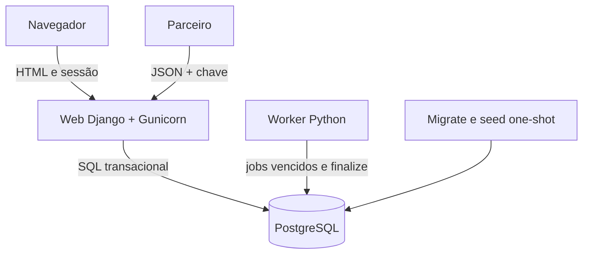
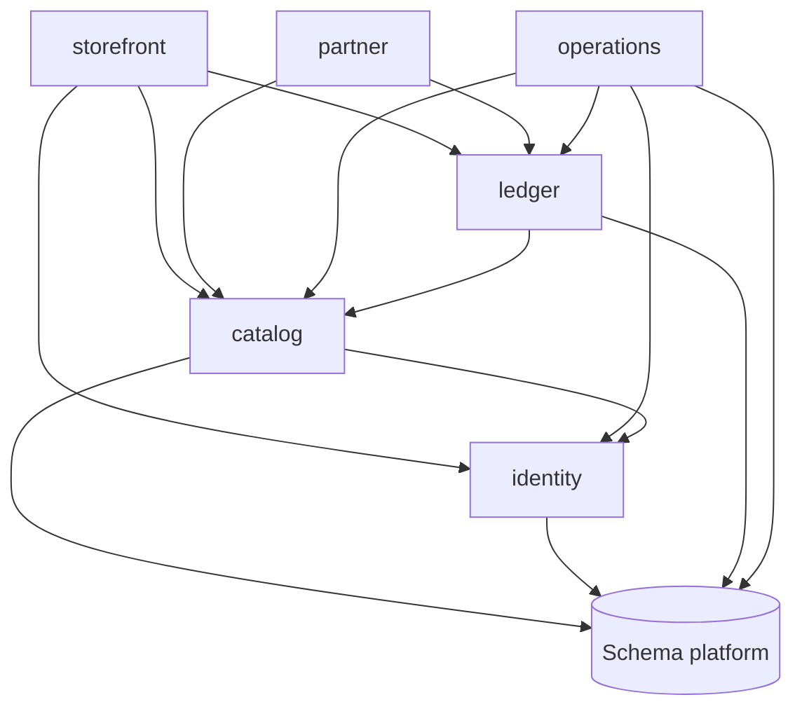
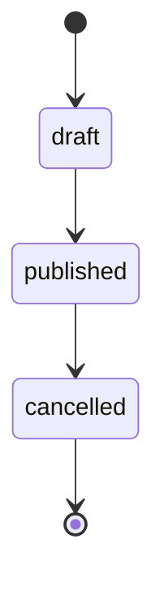
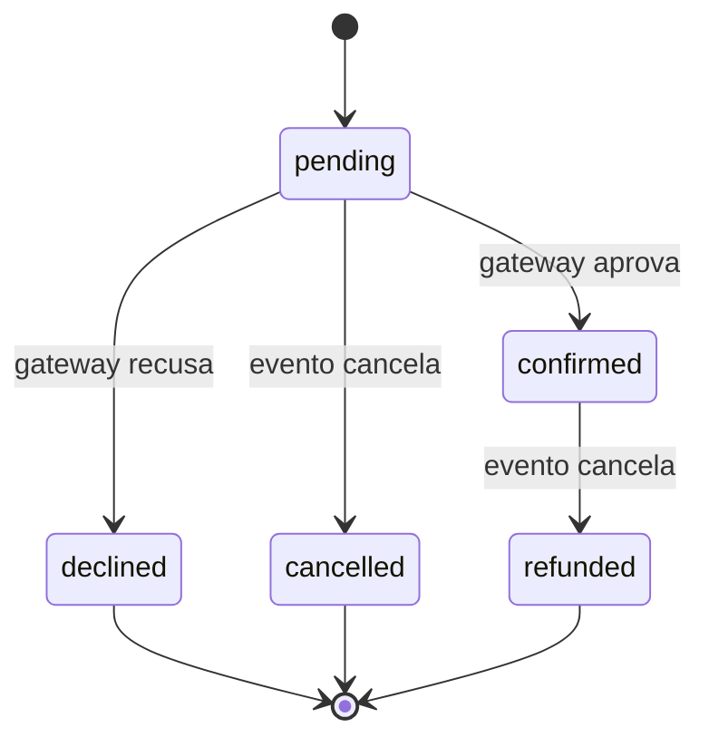
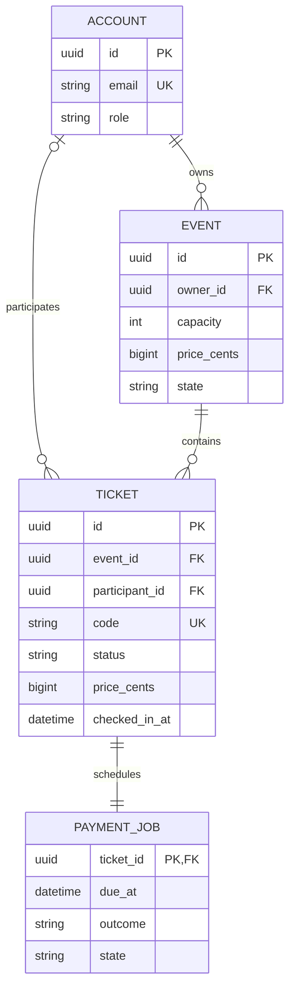
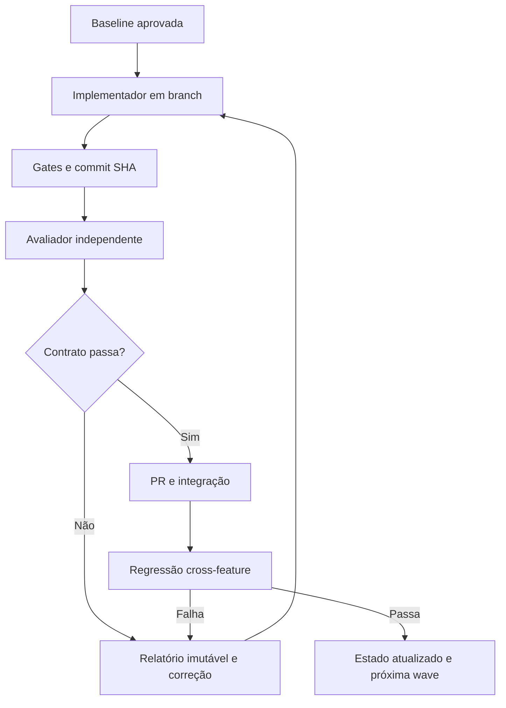

# Diagramas | visão C4 e fluxos Mermaid

C4 nível 1 (contexto), nível 2 (containers) e nível 3 (componentes) são suficientes; nível 4 de classes será derivado do código se necessário, sem inventar classes existentes. Mermaid textual, sem depender de plugin externo.

## C4 L1: contexto (representação em flowchart)



## C4 L2: containers



## C4 L3: módulos



## Compra e gateway

```mermaid
sequenceDiagram
 participant U as Canal web/API
 participant S as Reserve
 participant D as PostgreSQL
 participant W as Worker
 U->>S: Entrada válida
 S->>D: BEGIN e lock evento
 S->>D: COUNT e valida capacidade
 alt sem vaga
  S-->>U: sold_out
 else vaga
  S->>D: INSERT ticket e job; COMMIT
  S-->>U: pending
  W->>D: Buscar job vencido sem lock
  W->>D: BEGIN; lock evento; reler ticket/job
  alt evento publicado e pending
   W->>D: Confirmar ou recusar; job done
  else terminal
   W->>D: job ignored
  end
  W->>D: COMMIT
 end
```

## Estado de evento e ingresso





## Modelo de dados



## Avaliação e waves



O DAG de implementação fica no PRD. Rever diagramas quando contrato ou arquitetura mudar; rodar renderizador Mermaid no gate documental após instalar ferramenta com versão fixa. Esses diagramas foram redigidos, mas ainda não renderizados automaticamente neste pacote.
