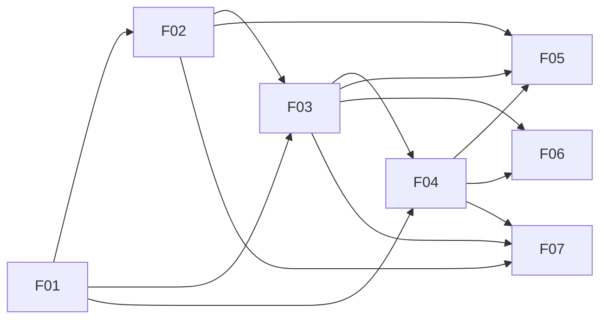

# PRD | Catraca

Status: proposta, aguardando aprovação W0. Público: produto, implementadores, avaliadores e integrador.

## Problema e resultado

Pequenos eventos precisam vender e controlar entradas sem que vendas simultâneas, pagamentos assíncronos e cancelamentos criem inconsistências. O MVP é aprovado por comportamento observável, não por quantidade de código nem estética.

## Personas e jornadas

Visitante consulta vitrine sem login. Participante cadastra nome/e-mail/senha, autentica, compra uma unidade, acompanha ingresso e código. Organizador sem cadastro público usa a seed para criar, publicar, editar, verificar código, cancelar e consultar indicadores de seus eventos. Parceiro usa chave e JSON; sua venda não cria conta web.

## Regras de negócio

| ID  | Obrigação                                                                                                                   |
| --- | --------------------------------------------------------------------------------------------------------------------------- |
| R01 | Evento com nome, início futuro, local, lotação inteira positiva e preço positivo; validar criação e edição.                 |
| R02 | Evento nasce draft; somente published, não cancelado, aparece no catálogo e aceita compra.                                  |
| R03 | Não reduzir lotação abaixo de ocupação; preço novo só para compras futuras.                                                 |
| R04 | URL própria de gestão para edição, publicação, cancelamento, check-in e painel.                                             |
| R05 | Ocupação = pending + confirmed; disponibilidade = capacidade menos ocupação, zero se cancelado.                             |
| R06 | Uma compra = um ingresso, web ou parceiro, pendente antes de resposta assíncrona.                                           |
| R07 | Esgotado na UI e 409 sold_out na API; não exceder capacidade sob concorrência.                                              |
| R08 | Gateway aprovado confirma; recusa libera a vaga.                                                                            |
| R09 | Código único, evento/status/código em Meus ingressos.                                                                       |
| R10 | Check-in com precedência e cinco mensagens exatas; uso é atributo separado.                                                 |
| R11 | Cancelamento publicado terminal; em até 10s confirmed→refunded, pending→cancelled; respostas tardias sem efeito.            |
| R12 | Painel dos dois canais: confirmados, pendentes, check-ins confirmados, vagas, receita histórica de confirmados, estornados. |
| R13 | Somente dono organizador acessa e opera seus eventos; visitante e participante excluídos da área.                           |

## Estados e linguagem

API: pending, confirmed, declined, cancelled, refunded. UI: pendente, confirmado, recusado, cancelado, estornado. `checkedIn` é booleano independente. Evento draft/published/cancelled. Cartão de 16 dígitos ASCII; finais 0001 aprova 2–5s, 0002 recusa 2–5s, 0003 aprova 30–40s, 0004 recusa 30–40s, outros recusam 2–5s. A API pública não muda (ver contrato OpenAPI).

## Fora de escopo

Deploy, pagamento real, notificações, aplicativo móvel, qualidade visual como gate, cadastro de organizador, múltiplos ingressos numa compra, assentos numerados, transferência/cancelamento individual, tempo real, operação em múltiplos fusos. Não acrescentar filtros que contradigam a listagem do brief.

## Features, contratos e ownership

### F01 | Ambiente reproduzível e persistência

**Provides:** Ambiente Compose, schema compartilhado, clock, runner, dados de demonstração e interfaces de registro de rotas.

**Consumes:** Nenhuma feature anterior.

**Área de escrita:** platform, migrations, boot, bin, CI. [Spec](../features/F01-fundacao/spec.md).

| Critério | Regras   | Aceite                                                                                                                                                                      |
| -------- | -------- | --------------------------------------------------------------------------------------------------------------------------------------------------------------------------- |
| A01      | H01      | Clone limpo: ./bin/up constrói, migra, semeia e espera web/worker/DB prontos; /health/ready retorna 200 sem configuração manual.                                            |
| A02      | H02      | ./bin/down encerra todos os containers e portas iniciados; nova subida conserva dados e seed não duplica contas.                                                            |
| A03      | H03      | ./bin/gates falha com teste quebrado, executa testes reais e lint, usa DB isolado e passa com testes válidos.                                                               |
| A04      | H04      | README e AGENTS.md descrevem os comandos, endpoints, contas e mapa; o padrão local usa somente simulador e não requer configuração de pagamento.                            |
| A05      | R05, R09 | Schema possui FKs, unicidade de código, restrições de status, lotação e preço; migrações reexecutáveis.                                                                     |
| A29      | H01, H03 | Gates rodam em projeto Compose distinto do ambiente de demonstração, sem remover volumes alheios; falha de bootstrap ou cleanup retorna não zero.                           |
| A37      | H03      | Gate documental diferencia baseline, candidato local e release; relatório incompleto, falso PASS, arquivo alterado ou estado inconsistente causam falha na fase apropriada. |

### F02 | Identidade e fronteiras de acesso

**Provides:** Cadastro/login/logout, sessão, funções require_participant e require_organizer + predicado de dono, identidade dos usuários da seed.

**Consumes:** F01: schema, seed e ambiente.

**Área de escrita:** identity, web account. [Spec](../features/F02-identidade/spec.md).

| Critério | Regras   | Aceite                                                                                                                                                                                     |
| -------- | -------- | ------------------------------------------------------------------------------------------------------------------------------------------------------------------------------------------ |
| A06      | R13      | Cadastro público cria somente participante, e-mail normalizado único; senha armazenada como hash; login válido e logout invalidam sessão; erro genérico em credenciais inválidas.          |
| A07      | R13      | Guarda de papel e predicado de dono são aplicados em todos os recursos de gestão; no contrato local, validar com fixtures e endpoints de teste; as rotas reais são validadas em X03 e X11. |
| A08      | R09, R13 | O serviço de identidade identifica participante por ID de sessão, não por e-mail ou parâmetro; parceiro não é uma identidade web. Titularidade real de ingressos é validada em X06/X16.    |
| A30      | R13      | Cadastro ignora papel recebido; sessão é rotacionada no login e invalidada no logout; mutações web exigem CSRF e redirecionamento local seguro.                                            |

### F03 | Administração e catálogo de eventos

**Provides:** CRUD limitado de evento, publicação, página de gestão /gestao/eventos/<id>/, consulta pública, lock e leitura canônica de ocupação.

**Consumes:** F01: schema e clock; F02: identidade e autorização.

**Área de escrita:** catalog, organizer event views. [Spec](../features/F03-eventos/spec.md).

| Critério | Regras   | Aceite                                                                                                                                                               |
| -------- | -------- | -------------------------------------------------------------------------------------------------------------------------------------------------------------------- |
| A09      | R01      | Nome/local não vazios; lotação inteira >=1; preço em centavos >0; início estritamente futuro em criar e editar, inclusive requisição direta.                         |
| A10      | R02, R04 | Evento nasce draft; publicar torna visível a consulta pública; gestão tem URL estável e lista apenas próprios eventos.                                               |
| A11      | R03, R05 | Editar sob lock do evento; capacidade abaixo de pending+confirmed é rejeitada; igual/acima aceita; preço novo não altera snapshot de ingressos.                      |
| A12      | R11      | Evento cancelled não pode ser alterado/republicado; catálogo e disponibilidade pública o excluem.                                                                    |
| A31      | R01, R03 | Edição revalida a data no instante da escrita e não aceita frações de vaga, centavos fracionários ou valores fora dos limites documentados; nenhuma escrita parcial. |

### F04 | Livro de ingressos e liquidação simulada

**Provides:** Serviço reserve, resolve_due, consulta de ingresso, job persistente e regras transacionais de venda.

**Consumes:** F01: DB/worker/clock; F03: evento bloqueável e ocupação.

**Área de escrita:** ledger, worker. [Spec](../features/F04-transacoes/spec.md).

| Critério | Regras        | Aceite                                                                                                                                                          |
| -------- | ------------- | --------------------------------------------------------------------------------------------------------------------------------------------------------------- |
| A13      | R05, R06, R09 | Uma compra válida retorna ingresso pending com ID/código únicos e job gravado na mesma transação, sem aguardar gateway; reserva já ocupa vaga.                  |
| A14      | R07           | Quando lotação esgota, não cria ingresso/job; 30 reservas concorrentes sobre capacidade 5 dão exatamente 5 sucessos/25 sold_out, em duas rodadas novas.         |
| A15      | R08           | Gateway padrão confirma 0001 e recusa 0002/outros em 2–5s; confirma 0003 e recusa 0004 em 30–40s; recusa libera uma vaga.                                       |
| A16      | R03, R11      | Snapshot de preço é capturado sob lock; finalize só altera pending de evento publicado; resultado duplicado/tardio não revive terminal; job sobrevive reinício. |
| A17      | R06           | Cartão diferente de 16 dígitos ASCII falha antes de criar ingresso; e-mail malformado na compra de parceiro falha; PAN não persiste nem aparece em logs.        |
| A32      | R06, R09      | Falha ao criar job reverte reserva; colisão de código usa savepoint e retry limitado; conflitos inesperados não viram sold_out.                                 |
| A33      | R07, R08, R11 | Worker concorrente obedece event→ticket→job e revalida estado/vencimento; nenhuma espera de gateway ou lock global; transação abortada é retomável.             |

### F05 | Jornada de participante

**Provides:** Vitrine pública, compra autenticada e página de ingressos pessoais.

**Consumes:** F02: participante/sessão; F03: catálogo; F04: reserve e consulta.

**Área de escrita:** participant web. [Spec](../features/F05-participante/spec.md).

| Critério | Regras        | Aceite                                                                                                                                            |
| -------- | ------------- | ------------------------------------------------------------------------------------------------------------------------------------------------- |
| A18      | R02, R05, R07 | Vitrine exibe só publicados não cancelados, inclusive esgotados com texto exato Ingressos esgotados; tentativa concorrente recebe mesma mensagem. |
| A19      | R06, R08, R09 | Participante cria conta, compra pela vitrine, vê evento/status/código em Meus ingressos; pending imediato e confirmado em até 5s para 0001.       |
| A20      | R09, R13      | Meus ingressos filtra por participant_id autenticado, não por e-mail, e mostra todos os cinco rótulos; visitante não compra.                      |

### F06 | Integração comercial por API

**Provides:** As três rotas /api/partner, autenticação por chave, tradução de DTOs e erros do domínio.

**Consumes:** F03: catálogo público; F04: compra/consulta.

**Área de escrita:** partner API. [Spec](../features/F06-parceiros/spec.md).

| Critério | Regras        | Aceite                                                                                                                                                                                                    |
| -------- | ------------- | --------------------------------------------------------------------------------------------------------------------------------------------------------------------------------------------------------- |
| A21      | API, R02, R05 | GET events com chave retorna array de publicados, id/name/startsAt/priceCents/availableSeats com tipos exatos; cancelados/drafts excluídos.                                                               |
| A22      | API, R06, R07 | POST compra responde 202 com ticketId/code/status pending; após chave, precedência 422 invalid_request, 404 event_not_available, 409 sold_out.                                                            |
| A23      | API, R09, R13 | GET ticket consulta ambos os canais e retorna ticketId/code/eventId/status/checkedIn booleano; desconhecido 404 ticket_not_found; todas as rotas sem chave ou chave errada 401 unauthorized.              |
| A24      | R07, API      | Em duas rodadas HTTP reais, cada evento novo de capacidade 5 recebe 30 POST simultâneos com cartão 0001: 5×202 e 25×409, sem 5xx; depois 5 confirmados.                                                   |
| A34      | API, R06, R07 | Autorização antecede leitura/parse do corpo; JSON inválido, null, array, tipo errado, cartão Unicode e e-mail inválido respondem 422 após chave válida; precedência vale em eventos ausentes e esgotados. |

### F07 | Operação do evento e apuração

**Provides:** Ações de gestão, cancelamento atômico, check-in serializado, painel coerente com todos os estados e canais.

**Consumes:** F02: dono; F03: página/lock/estado; F04: ingressos, preço e job.

**Área de escrita:** operations, management partial. [Spec](../features/F07-operacao/spec.md).

| Critério | Regras        | Aceite                                                                                                                                                                                                                                              |
| -------- | ------------- | --------------------------------------------------------------------------------------------------------------------------------------------------------------------------------------------------------------------------------------------------- |
| A25      | R10           | A decisão de check-in respeita a precedência R10 e somente um pedido concorrente pode marcar entrada; no evento cancelado, a página oculta o formulário, e POST direto mantém precedência.                                                          |
| A26      | R11           | Cancelar evento publicado é uma operação terminal; em até 10 s (baseline: no mesmo commit), pending passa a cancelled e confirmed a refunded; declined permanece; nenhuma resposta tardia reabre ingresso. Rejeitar edição e republicação por POST. |
| A27      | R05, R12      | As seis métricas usam uma consulta coerente sobre evento e ingressos, sem contadores de canal; preço histórico apenas de confirmed. Cancelamento zera tudo exceto estornados.                                                                       |
| A28      | R04, R13      | Check-in, cancelar e painel ficam na URL de gestão de cada evento; todas as ações exigem dono inclusive requisição direta.                                                                                                                          |
| A35      | R05, R11, R12 | Leitura de gestão/painel usa snapshot único incluindo capacidade/status/owner e agregados; corridas de edição e cancelamento não produzem combinações impossíveis.                                                                                  |
| A36      | R07, R10, R11 | Corridas reserva/cancelamento, gateway/cancelamento e check-in/cancelamento terminam em estado serial válido, sem 5xx ou entrada após cancelamento.                                                                                                 |

## Grafo de dependências

| Wave | Features      | Saída                                          |
| ---- | ------------- | ---------------------------------------------- |
| W1   | F01           | Aprovação local e merge; freeze das interfaces |
| W2   | F02           | Aprovação local e merge; freeze das interfaces |
| W3   | F03           | Aprovação local e merge; freeze das interfaces |
| W4   | F04           | Aprovação local e merge; freeze das interfaces |
| W5   | F05, F06, F07 | Aprovação local e merge; freeze das interfaces |

W0 aprova design; W5 contém três branches independentes. W6 verifica relações de integração, não dependências de implementação.

## Critérios cross-feature

| ID  | Provider → Consumer | Fase       | Regras                       | Aceite                                                                                                                                                                                                        |
| --- | ------------------- | ---------- | ---------------------------- | ------------------------------------------------------------------------------------------------------------------------------------------------------------------------------------------------------------- |
| X01 | F01 → F02           | local      | H01, H02                     | Após up com seed, A/B/P autenticam; duas execuções da seed não duplicam contas.                                                                                                                               |
| X02 | F01 → F03           | local      | H01, R01                     | Migração e clock da fundação permitem criação e rejeição de data vencida.                                                                                                                                     |
| X03 | F02 → F03           | local      | R04, R13                     | URL de gestão e listagem usam dono da sessão; B não pode editar/publicar A.                                                                                                                                   |
| X04 | F01 → F04           | local      | H01, R08                     | Worker do Compose consome job persistido após reinício sem chave real.                                                                                                                                        |
| X05 | F03 → F04           | local      | R02, R03, R05, R07           | Reserve usa mesmo lock de editar; draft/cancelled recusam, alteração de capacidade não gera sobrelotação.                                                                                                     |
| X06 | F02 → F05           | local      | R09, R13                     | Sessão define dono do ingresso; anônimo e outra conta não veem compra pessoal.                                                                                                                                |
| X07 | F03 → F05           | local      | R02, R05                     | A publicação e as vagas calculadas por F03 chegam à vitrine; draft/cancelled não são exibidos, inclusive fixture cancelada. A ação real de cancelar é validada em X14.                                        |
| X08 | F04 → F05           | local      | R06, R08, R09                | Compra web usa reserve e worker; pendente ocupa e recusa libera na vitrine.                                                                                                                                   |
| X09 | F03 → F06           | local      | R02, R03, R05, API           | A listagem de parceiros reflete publicação, preço e capacidade de F03; fixtures draft/cancelled ficam fora. Cancelamento real será validado em X15.                                                           |
| X10 | F04 → F06           | local      | R06, R07, R09, API           | API usa mesmo reserve/consulta: carga, códigos e estados, inclusive ticket web fixture.                                                                                                                       |
| X16 | F05 → F06           | integrated | R05, R07, R09, API           | Integração final: canais disputam mesma última vaga; consulta partner aceita ticket web e compra partner não entra em conta web.                                                                              |
| X11 | F02 → F07           | local      | R13                          | Todas as ações operacionais respeitam guarda de dono.                                                                                                                                                         |
| X12 | F03 → F07           | local      | R04, R11                     | Cancelamento bloqueia publicação/edição e integra gestão em URL existente.                                                                                                                                    |
| X13 | F04 → F07           | local      | R10, R11, R12                | Check-in/painel/cancelamento compartilham status, lock e preço; gateway tardio não revive.                                                                                                                    |
| X14 | F05 → F07           | integrated | R06, R09, R10, R11, R12      | Com UI e operações integradas, uma compra web confirmada incrementa painel, permite check-in e, após cancelamento, some do catálogo e vira estornada em Meus ingressos.                                       |
| X15 | F06 → F07           | integrated | R05, R07, R10, R11, R12, API | Com API e operações integradas, ingresso de parceiro conta na lotação e painel, permite check-in e consulta checkedIn; cancelar remove evento da lista, bloqueia POST, estorna e conserva consulta do ticket. |

## Critérios de entrega

| ID  | Aceite                                                                                                                                                                                       |
| --- | -------------------------------------------------------------------------------------------------------------------------------------------------------------------------------------------- |
| P01 | PRD >=5 features, fornece/consome, DAG e waves; todas R01–R13 citadas, cada aresta coberta.                                                                                                  |
| P02 | Spec, plano e contrato por feature, todos os critérios e cross-feature mapeados.                                                                                                             |
| P03 | Para cada feature há relatório novo e imutável, com data UTC, SHA completo, ferramenta, modelo, identidade de sessão e evidência por item; último relatório integrado aprova tudo aplicável. |
| P04 | Estado final aponta ao último relatório aprovado, commit implementado e PR de cada feature; nenhum concluído sem integração verificada.                                                      |
| P05 | Pelo menos uma wave paralela via PRs mergeados; primeiro commit de cada PR anterior ao último de todos os demais.                                                                            |
| P06 | Repo público único, main com README completo; fluxo externo 1–18 aprovado em clone limpo.                                                                                                    |

## Indicadores de sucesso

100% de itens de contrato aprovados na fase correta; 0 sobrelotação, 0 dados vazados, 0 falhas do fluxo de 18 passos; todos os PRs requeridos e históricos de relatórios presentes.
