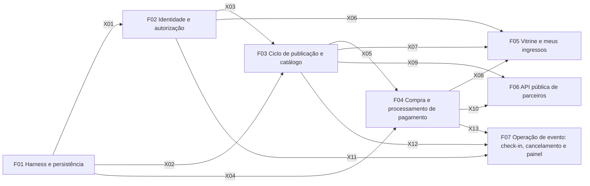

# PRD | Catraca

Status: baseline proposta. Público: fundadora, desenvolvedores, agentes e avaliador. O brief enviado é fonte normativa; critérios abaixo são sua operacionalização, não fatos sobre software já existente.

## Usuários e jornadas

Visitante consulta eventos à venda. Participante cria conta (nome, e-mail, senha), entra/sai, compra uma unidade e acompanha status/código. Organizador, criado exclusivamente pela seed, lista, cria, edita, publica, cancela, faz check-in e consulta métricas dos próprios eventos. Parceiro usa chave de API sem conta web, compra para e-mail informado e consulta tickets de ambos os canais.

## Requisitos de produto

| Regra | Comportamento |
|---|---|
| R01 | Evento: nome, início futuro ao criar/editar, local, lotação inteira positiva, preço positivo. |
| R02 | Nasce rascunho; apenas publicado não cancelado é comercializável e listado. |
| R03 | Capacidade >= ocupação; preço histórico imutável. |
| R04 | Gestão por URL própria com edição, publicação, cancelamento, check-in e painel. |
| R05 | Ocupação = pending + confirmed; disponíveis = capacidade − ocupação, zero se cancelado. |
| R06 | Compra unitária por web/API; cria pending e reserva antes da resposta, sem esperar gateway. |
| R07 | Esgotamento com mensagens e HTTP fixos; jamais vender acima da capacidade. |
| R08 | Aprovação confirma; recusa libera vaga. |
| R09 | Código único e lista pessoal com evento, status e código. |
| R10 | Check-in conforme ordem e mensagens exatas definidas no design. |
| R11 | Cancelamento publicado irrevogável; pending→cancelled, confirmed→refunded <=10s; gateway tardio inócuo. |
| R12 | Painel de ambos os canais: confirmados, pendentes, check-ins confirmados, vagas, receita histórica, estornados. |
| R13 | Isolamento de dono e restrição da gestão a organizadores. |
| API | Contrato externo exato, chave obrigatória, validação antes de evento e lotação; ver design. |
| H01–H04 | Harness, seed, documentação, modo simulado e gates. |
| P01–P06 | Processo SDD, independência, tracking, paralelismo, entrega. |

## Fora de escopo

Produção, gateway real, notificações, mobile/estética avançada, cadastro de organizadores, compra múltipla, mapa de lugares, cancelamento/transferência individual, push de atualizações e regras complexas de fuso. Ver proposta.

## Features e interfaces

| ID | Nome | Wave | Provides | Consumes |
|---|---|---|---|---|
| F01 | Harness e persistência | W1 | Ambiente Compose, schema compartilhado, clock, runner, dados de demonstração e interfaces de registro de rotas. | Nenhuma feature anterior. |
| F02 | Identidade e autorização | W2 | Cadastro/login/logout, sessão, funções require_participant e require_owner, identidade dos usuários da seed. | F01: schema, seed e ambiente. |
| F03 | Ciclo de publicação e catálogo | W3 | CRUD limitado de evento, publicação, página de gestão /organizer/events/{id}/, consulta pública, lock e leitura canônica de ocupação. | F01: schema e clock; F02: identidade e autorização. |
| F04 | Compra e processamento de pagamento | W4 | Serviço reserve, finalize_payment, consulta de ingresso, job persistente e regras transacionais de venda. | F01: DB/worker/clock; F03: evento bloqueável e ocupação. |
| F05 | Vitrine e meus ingressos | W5 | Vitrine pública, compra autenticada e página de ingressos pessoais. | F02: participante/sessão; F03: catálogo; F04: reserve e consulta. |
| F06 | API pública de parceiros | W5 | As três rotas /api/partner, autenticação por chave, tradução de DTOs e erros do domínio. | F03: catálogo público; F04: compra/consulta. |
| F07 | Operação de evento: check-in, cancelamento e painel | W5 | Ações de gestão, cancelamento atômico, check-in serializado, painel coerente com todos os estados e canais. | F02: dono; F03: página/lock/estado; F04: ingressos, preço e job. |

## Grafo e waves

W1 F01; W2 F02; W3 F03; W4 F04; W5 F05/F06/F07 (branches simultâneas); W6 integração final, sem feature nova. X14–X16 são relações de validação entre pares, não arestas de dependência para implementação. Cada wave inicia após merge e aprovação da anterior.

## Critérios de aceite por feature

### F01 | Harness e persistência

- **A01** (H01): Clone limpo: ./bin/up constrói, migra, semeia e espera web/worker/DB prontos; /health/ready retorna 200 sem configuração manual.
- **A02** (H02): ./bin/down encerra todos os containers e portas iniciados; nova subida conserva dados e seed não duplica contas.
- **A03** (H03): ./bin/gates falha com teste quebrado, executa testes reais e lint, usa DB isolado e passa com testes válidos.
- **A04** (H04): AGENTS.md e README contêm comandos, endereços, credenciais de seed, mapa; modo padrão não exige gateway real.
- **A05** (R05,R09): Schema possui FKs, unicidade de código, restrições de status, lotação e preço; migrações reexecutáveis.

### F02 | Identidade e autorização

- **A06** (R13): Cadastro público cria somente participante, e-mail normalizado único; senha armazenada como hash; login válido e logout invalidam sessão; erro genérico em credenciais inválidas.
- **A07** (R13): Visitante e participante não acessam rotas de gestão; B não lê nem modifica eventos de A, incluindo URL direta e POST forjado.
- **A08** (R09,R13): Participante só tem acesso aos próprios recursos; parceiro não cria sessão web nem vincula conta pelo e-mail.

### F03 | Ciclo de publicação e catálogo

- **A09** (R01): Nome/local não vazios; lotação inteira >=1; preço em centavos >0; início estritamente futuro em criar e editar, inclusive requisição direta.
- **A10** (R02,R04): Evento nasce draft; publicar torna visível a consulta pública; gestão tem URL estável e lista apenas próprios eventos.
- **A11** (R03,R05): Editar sob lock do evento; capacidade abaixo de pending+confirmed é rejeitada; igual/acima aceita; preço novo não altera snapshot de ingressos.
- **A12** (R11): Evento cancelled não pode ser alterado/republicado; catálogo e disponibilidade pública o excluem.

### F04 | Compra e processamento de pagamento

- **A13** (R05,R06,R09): Uma compra válida retorna ingresso pending com ID/código únicos e job gravado na mesma transação, sem aguardar gateway; reserva já ocupa vaga.
- **A14** (R07): Quando lotação esgota, não cria ingresso/job; 30 reservas concorrentes sobre capacidade 5 dão exatamente 5 sucessos/25 sold_out, em duas rodadas novas.
- **A15** (R08): Gateway padrão confirma 0001 e recusa 0002/outros em 2–5s; confirma 0003 e recusa 0004 em 30–40s; recusa libera uma vaga.
- **A16** (R03,R11): Snapshot de preço é capturado sob lock; finalize só altera pending de evento publicado; resultado duplicado/tardio não revive terminal; job sobrevive reinício.
- **A17** (R06): Cartão diferente de 16 dígitos ASCII falha antes de criar ingresso; e-mail malformado na compra de parceiro falha; PAN não persiste nem aparece em logs.

### F05 | Vitrine e meus ingressos

- **A18** (R02,R05,R07): Vitrine exibe só publicados não cancelados, inclusive esgotados com texto exato Ingressos esgotados; tentativa concorrente recebe mesma mensagem.
- **A19** (R06,R08,R09): Participante cria conta, compra pela vitrine, vê evento/status/código em Meus ingressos; pending imediato e confirmado em até 5s para 0001.
- **A20** (R09,R13): Meus ingressos filtra por participant_id autenticado, não por e-mail, e mostra todos os cinco rótulos; visitante não compra.

### F06 | API pública de parceiros

- **A21** (API,R02,R05): GET events com chave retorna array de publicados, id/name/startsAt/priceCents/availableSeats com tipos exatos; cancelados/drafts excluídos.
- **A22** (API,R06,R07): POST compra responde 202 com ticketId/code/status pending; após chave, precedência 422 invalid_request, 404 event_not_available, 409 sold_out.
- **A23** (API,R09,R13): GET ticket consulta ambos os canais e retorna ticketId/code/eventId/status/checkedIn booleano; desconhecido 404 ticket_not_found; todas as rotas sem chave ou chave errada 401 unauthorized.
- **A24** (R07,API): Em duas rodadas HTTP reais, cada evento novo de capacidade 5 recebe 30 POST simultâneos com cartão 0001: 5×202 e 25×409, sem 5xx; depois 5 confirmados.

### F07 | Operação de evento: check-in, cancelamento e painel

- **A25** (R10): Check-in aplica exatamente as cinco mensagens na ordem definida; só confirmed não utilizado recebe checkedIn=true; dois check-ins concorrentes liberam uma entrada.
- **A26** (R11): Cancelar publicado é irreversível; na mesma transação confirmed→refunded e pending→cancelled, sem alteração de declined; gateway posterior não modifica; edit/publish/compra rejeitados.
- **A27** (R05,R12): Painel mostra seis métricas com snapshots de preço e ambos os canais; check-ins somente confirmed; cancelado tem receita/vagas/confirmados/pendentes/check-ins zero.
- **A28** (R04,R13): Check-in, cancelar e painel ficam na URL de gestão de cada evento; todas as ações exigem dono inclusive requisição direta.

## Critérios cross-feature

| ID | Provedor → consumidor | Regras | Aceite |
|---|---|---|---|
| X01 | F01 → F02 | H01,H02 | Após up com seed, A/B/P autenticam; duas execuções da seed não duplicam contas. |
| X02 | F01 → F03 | H01,R01 | Migração e clock da fundação permitem criação e rejeição de data vencida. |
| X03 | F02 → F03 | R04,R13 | URL de gestão e listagem usam dono da sessão; B não pode editar/publicar A. |
| X04 | F01 → F04 | H01,R08 | Worker do Compose consome job persistido após reinício sem chave real. |
| X05 | F03 → F04 | R02,R03,R05,R07 | Reserve usa mesmo lock de editar; draft/cancelled recusam, alteração de capacidade não gera sobrelotação. |
| X06 | F02 → F05 | R09,R13 | Sessão define dono do ingresso; anônimo e outra conta não veem compra pessoal. |
| X07 | F03 → F05 | R02,R05 | Publicar/lotar/cancelar reflete na vitrine sem cache obsoleto. |
| X08 | F04 → F05 | R06,R08,R09 | Compra web usa reserve e worker; pendente ocupa e recusa libera na vitrine. |
| X09 | F03 → F06 | R02,R03,R05,API | API usa catálogo e centavos/ocupação canônicos; edição preço/capacidade reflete na listagem. |
| X10 | F04 → F06 | R06,R07,R09,API | API usa mesmo reserve/consulta: carga, códigos e estados, inclusive ticket web fixture. |
| X11 | F02 → F07 | R13 | Todas as ações operacionais respeitam guarda de dono. |
| X12 | F03 → F07 | R04,R11 | Cancelamento bloqueia publicação/edição e integra gestão em URL existente. |
| X13 | F04 → F07 | R10,R11,R12 | Check-in/painel/cancelamento compartilham status, lock e preço; gateway tardio não revive. |
| X14 | F05 → F07 | R06,R09,R10,R11,R12 | Integração final (não dependência de implementação): compra web aparece no painel e permite check-in; cancelamento aparece em Meus ingressos. |
| X15 | F06 → F07 | R05,R07,R10,R11,R12,API | Integração final: compra partner soma painel, é validada no check-in e deixa API após cancelamento. |
| X16 | F05 → F06 | R05,R07,R09,API | Integração final: canais disputam mesma última vaga; consulta partner aceita ticket web e compra partner não entra em conta web. |

## Critérios de processo

- **P01** (SDD): PRD >=5 features, fornece/consome, DAG e waves; todas R01–R13 citadas, cada aresta coberta.
- **P02** (SDD): Spec, plano e contrato por feature, todos os critérios e cross-feature mapeados.
- **P03** (EVAL): Cada feature aprovada em avaliação independente; relatório imutável com data, SHA, ferramenta, modelo, evidência por item.
- **P04** (STATE): Estado final bate com relatórios existentes e mais recentes; sem status concluído sem aprovação.
- **P05** (PAR): Pelo menos uma wave paralela via PRs mergeados; primeiro commit de cada PR anterior ao último de todos os demais.
- **P06** (DELIVERY): Repo público único, main com README completo; fluxo externo 1–18 aprovado em clone limpo.

## Critério final de release

Todos A/X/P aprovados nos respectivos gates e contratos, fluxo 1–18 em clone limpo da main. Relatório antigo aprovado não substitui regressão final. Nenhum item obrigatório pode ser marcado dispensado sem alterar formalmente o escopo (as regras do desafio não são negociáveis).
